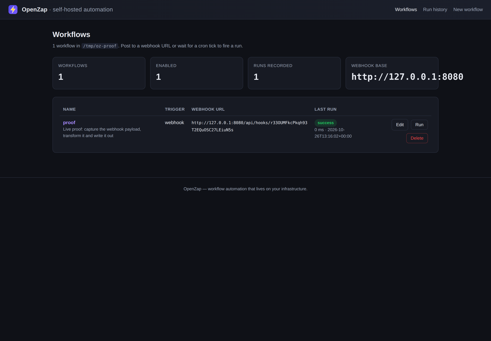
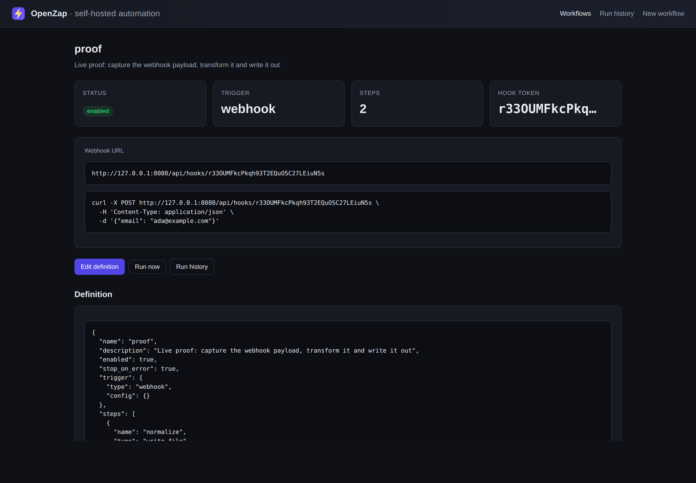
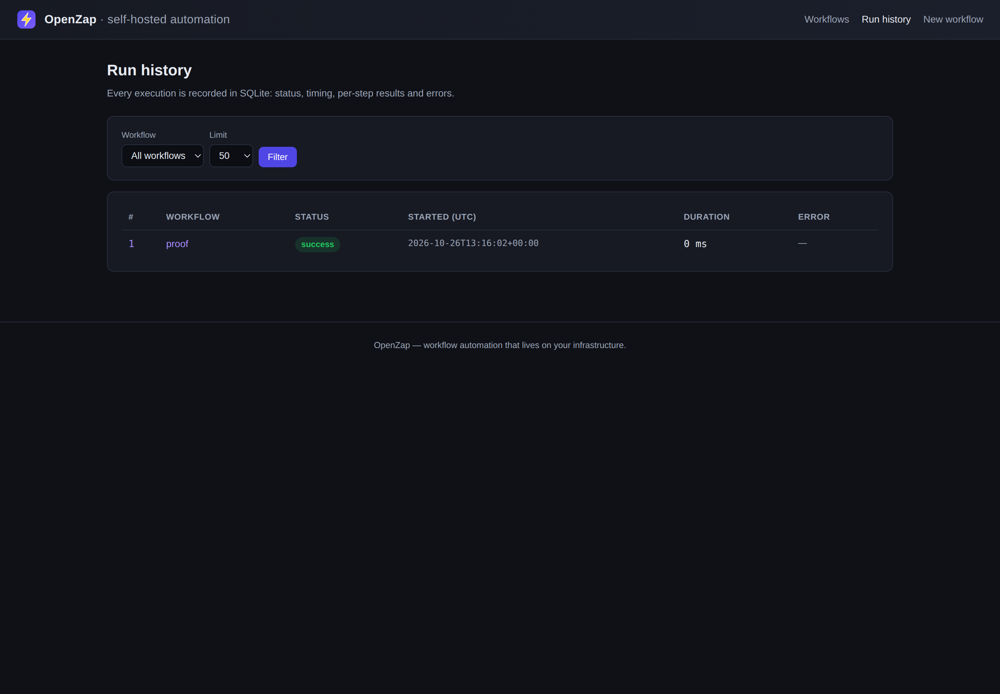

<p align="center">
  
</p>

<h1 align="center">OpenZap</h1>

<p align="center">
  <strong>A lightweight, self-hosted workflow automation engine.</strong><br>
  Wire triggers to actions in plain JSON. Runs on your machine, your data, your cron.
</p>

<p align="center">
  
  
  
  
</p>

---

## What is OpenZap?

OpenZap is a small, dependency-light workflow automation engine in the same
spirit as Zapier and n8n: you describe a **trigger** and a list of **steps**,
and OpenZap runs the steps in order whenever the trigger fires.

It is deliberately minimal. There are no app credentials to manage, no vendor
lock-in, no per-task metering and nothing that leaves your infrastructure. A
workflow is a JSON file; the runtime is one FastAPI process; state is one
SQLite database.

```
            +---------------------+
   POST --->|  /api/hooks/<token> |   webhook trigger
            +----------+----------+
                       |
  every 5 min +----+   v
  +------------+ |   +------------------+
  | cron tick  | +-->|  execution engine|--> action 1 --> action 2 --> action 3
  +------------+   |   +------------------+                 |
                   |             |                          v
                   |             +--------------------> SQLite run log
                   +--------------------------> JSON workflow files on disk
```

## Why not just use Zapier?

Zapier Pro is US$59.99/month for unlimited tasks, premium apps, multi-step
Zaps and scheduling. That is fine until any of the following bites you:

| Pain with hosted automation | How OpenZap differs |
| --- | --- |
| **Per-task pricing** — every action executed is a billable task, and high-volume events (webhooks, cron fans-out) get expensive fast | Unmetered. Runs are as cheap as CPU time on a machine you already run |
| **Vendor lock-in** — workflows live on Zapier's servers and cannot be exported as plain text | A workflow is a JSON file. Commit it to git, diff it, review it, back it up |
| **Data leaves your infrastructure** — payload contents are sent to and stored by a third party | Everything stays on your box; workflows, payloads and logs never leave it |
| **Credentials managed by the vendor** — your API keys are held by the automation platform | Secrets stay in your own `.env` / process environment |
| **No control over failures** — retries, logging and debugging are bounded by the product | Every run is logged in SQLite with per-step results and error messages |

OpenZap is **not** a full Zapier replacement: it does not ship hundreds of
pre-built app integrations. The trick is that most "integrations" are really
HTTP endpoints, files, email and log lines, so OpenZap implements those
primitives well and lets you plug anything else in through `http_request`.

## Features

- **Two trigger types**
  - `webhook` — a unique random URL per workflow (`/api/hooks/<token>`) that
    fires the workflow on `POST`, capturing body, headers, query and raw text.
    Optional HMAC-SHA256 signature verification via a shared secret.
  - `schedule` — a standard 5-field cron expression executed by APScheduler.
- **Five working actions**
  - `http_request` — any verb, templated headers/body/params, basic auth,
    redirect following, configurable timeout and success-status range.
  - `email` — SMTP delivery from environment config; recorded as `skipped`
    instead of failing when SMTP is not configured.
  - `slack_webhook` — post to a Slack incoming-webhook URL (refuses to POST
    Slack messages to arbitrary hosts unless explicitly opted in).
  - `write_file` — write the payload or a template to disk (JSON, JSONL append
    or plain text), sandboxed to the data directory when paths are relative.
  - `log` — append a structured JSONL record with timestamp, workflow, step,
    level, message and arbitrary data.
- **Safe templating** — `{{ trigger.body.email }}`-style placeholders resolved
  by walking dictionaries and lists only. No `eval`, no attribute access, no
  builtins. A typo fails the step loudly instead of silently emitting `""`.
- **Ordered execution with `stop_on_error`** — steps run in the order you
  define them and each step's result is available to the next via
  `{{ steps.<name>.response.status_code }}`.
- **Full run history in SQLite** — workflow, trigger type, status, started and
  finished timestamps, duration, per-step results and the error message.
- **CLI plus a server-rendered web UI** — manage workflows, print webhook URLs,
  run things by hand and read history from a terminal or a browser. No React
  build step, no frontend framework, no Node.
- **JSON-first config** — workflow definitions are validated on save and can
  be versioned in git. YAML files are accepted when `PyYAML` is installed.

## Architecture

```
openzap/
├── config.py        # Settings resolved from environment variables
├── errors.py        # OpenZapError / WorkflowError / TemplateError / ActionError
├── util.py          # shared helpers (timestamps, tokens)
├── templates.py     # safe {{ placeholder }} substitution engine
├── workflow.py      # workflow schema validation (JSON + optional YAML)
├── storage.py       # workflow JSON files on disk + SQLite index and run log
├── engine.py        # ordered step execution, stop_on_error, error capture
├── triggers.py      # webhook/schedule/manual trigger envelopes
├── scheduler.py     # APScheduler CronTrigger synchronisation
├── server.py        # FastAPI app: /api/* routes and /api/hooks/<token>
├── webui.py         # Jinja2 dashboard, run history, workflow editor
├── cli.py           # argparse CLI (openzap console script)
├── actions/         # http_request, email, slack_webhook, write_file, log
├── templates/       # server-rendered HTML (dark theme, no build step)
└── static/          # favicon.svg served to the UI
```

Data layout under `OPENZAP_HOME` (default `~/.openzap`):

```
~/.openzap/
├── openzap.db           # SQLite: workflows index + runs log
├── workflows/*.json     # one file per workflow (edit freely, version in git)
└── logs/runs.jsonl      # default target of the log action
```

Every execution is recorded in the `runs` table, so the browser UI and the
`openzap history` command are just readers over the same SQLite file.

## Installation

Requires Python 3.10 or newer.

```bash
git clone https://github.com/0xshaikh/openzap.git
cd openzap

python3 -m venv .venv
source .venv/bin/activate
pip install -r requirements.txt
pip install -e .
```

Or with `make`:

```bash
make install      # pip install -r requirements.txt && pip install -e .
make init         # openzap init  (creates the data dir + a sample workflow)
make serve        # openzap serve --port 8080
make test         # pytest -q
```

> **Tip:** `python3` in some container images points at a stripped-down
> interpreter without `pip`. If `python3 -m pip` is missing, install into a
> venv with `uv venv && uv pip install -r requirements.txt` instead.

## Quickstart

```bash
openzap init                 # creates ~/.openzap and imports a sample workflow
openzap serve --port 8080    # starts the app, webhook routes and cron scheduler
```

Then open <http://127.0.0.1:8080> in a browser: you get a dashboard listing
every workflow, its webhook URL and its most recent run.

### A worked example

Save this as `contact-form.json` — an inbound form webhook that emails the
lead and appends a row to a JSONL file:

```json
{
  "name": "contact-form-notifications",
  "description": "Accept a contact-form webhook, email the lead and append a row to a JSONL file.",
  "enabled": true,
  "stop_on_error": true,
  "trigger": { "type": "webhook", "config": {} },
  "steps": [
    {
      "name": "notify",
      "type": "email",
      "to": "you@example.com",
      "subject": "New message from {{ trigger.body.name }}",
      "body": "Name: {{ trigger.body.name }}\nEmail: {{ trigger.body.email }}\n\n{{ trigger.body.message }}"
    },
    {
      "name": "persist",
      "type": "write_file",
      "path": "leads.jsonl",
      "data": "{{ trigger.body }}",
      "append": true
    },
    {
      "name": "ack",
      "type": "log",
      "message": "stored lead {{ trigger.body.email }} at {{ steps.persist.path }}"
    }
  ]
}
```

Import and fire it:

```bash
openzap import contact-form.json
openzap webhook-url contact-form-notifications
# http://127.0.0.1:8080/api/hooks/x7f3…-token…

curl -X POST "http://127.0.0.1:8080/api/hooks/x7f3…-token…" \
  -H 'Content-Type: application/json' \
  -d '{"name": "Ada Lovelace", "email": "ada@example.com", "message": "It works!"}'

openzap history --workflow contact-form-notifications
```

Response:

```json
{
  "status": "success",
  "workflow": "contact-form-notifications",
  "run_id": 1,
  "duration_ms": 12,
  "steps": [
    { "name": "notify", "type": "email", "status": "success" },
    { "name": "persist", "type": "write_file", "status": "success" },
    { "name": "ack", "type": "log", "status": "success" }
  ]
}
```

### A scheduled example

Cron-triggered runs read their payload from `trigger.config.payload`:

```json
{
  "name": "nightly-repo-snapshot",
  "description": "Every night at 03:15 UTC, fetch repo metadata and write it to disk.",
  "enabled": true,
  "trigger": { "type": "schedule", "config": { "cron": "15 3 * * *" } },
  "steps": [
    {
      "name": "fetch",
      "type": "http_request",
      "method": "GET",
      "url": "https://api.github.com/repos/0xshaikh/openzap",
      "headers": { "Accept": "application/vnd.github+json" },
      "timeout": 20
    },
    {
      "name": "write",
      "type": "write_file",
      "path": "snapshots/openzap.json",
      "data": "{{ steps.fetch.response.body }}"
    }
  ]
}
```

More realistic workflows live in [`examples/`](examples/).

## Templating reference

Placeholders use `{{ path.to.value }}` and are resolved before every step runs.
Only dictionaries and lists are traversed, so a template can never execute code.

| Placeholder | Meaning |
| --- | --- |
| `{{ trigger.body.email }}` | A field from the incoming payload (webhook body or schedule payload) |
| `{{ trigger.headers.host }}` | A request header. Dashes are normalised, so `x_api_key` matches `x-api-key` |
| `{{ trigger.headers["X-Request-Id"] }}` | Quoted key form for names outside `[A-Za-z0-9_-]` |
| `{{ trigger.query.source }}` | A query-string parameter |
| `{{ trigger.raw }}` | The raw request body, truncated to 20 KB |
| `{{ trigger.received_at }}` | ISO-8601 UTC timestamp of receipt |
| `{{ steps.fetch.response.status_code }}` | Output of an earlier step, by that step's `name` |
| `{{ steps.fetch.response.body.count }}` | Nested step output |
| `{{ env.SMTP_FROM }}` | Any `OPENZAP_*` or `SMTP_*` environment variable |
| `{{ workflow.name }}` | The workflow's own name and description |
| `{{ now.iso }}` / `{{ now.unix }}` | Current UTC time of the run |
| `{{ items[0].id }}` / `{{ items.0.id }}` | Integer index into a list |

Semantics worth knowing:

- If a whole string is exactly one placeholder, the value keeps its native
  type — `"data": "{{ trigger.body }}"` forwards the parsed JSON object, not a
  JSON-encoded string. This is what makes `"body": "{{ steps.fetch.response.body }}"`
  pass structured data between steps.
- Inside a longer string values are stringified: `None` becomes `""`, booleans
  become `true` / `false`, dicts and lists are JSON-encoded.
- **A missing key raises `TemplateError`** and fails the step. Nothing is
  silently replaced with an empty string, so typos show up in the run log
  immediately.
- Internal context keys prefixed with `_` (settings, store) are not
  addressable from templates.

## Webhook usage

Each webhook-triggered workflow gets its own high-entropy token.

```bash
openzap webhook-url contact-form-notifications
# http://127.0.0.1:8080/api/hooks/YOUR-TOKEN
```

Post JSON with `curl`:

```bash
curl -X POST "http://127.0.0.1:8080/api/hooks/YOUR-TOKEN?source=demo" \
  -H 'Content-Type: application/json' \
  -H 'X-Trace: 01HZY7…' \
  -d '{"email": "ada@example.com", "subject": "Hello"}'
```

Or in Python:

```python
import requests

requests.post(
    "http://127.0.0.1:8080/api/hooks/YOUR-TOKEN",
    json={"email": "ada@example.com", "subject": "Hello"},
    timeout=10,
)
```

The response is a JSON summary (`status`, `workflow`, `run_id`, `duration_ms`,
per-step statuses), and the full record — including headers, query string and
every step's result — is stored in SQLite and visible at
`/runs` in the browser.

### Signing webhooks

Set a shared secret in the workflow trigger config:

```json
"trigger": { "type": "webhook", "config": { "secret": "a-long-random-string" } }
```

Then sign the raw body and send the digest:

```bash
BODY='{"email":"ada@example.com"}'
SIG="sha256=$(printf %s "$BODY" | openssl dgst -sha256 -hmac "a-long-random-string" | sed 's/^.*= //')"
curl -X POST "http://127.0.0.1:8080/api/hooks/YOUR-TOKEN" \
  -H 'Content-Type: application/json' \
  -H "X-OpenZap-Signature: $SIG" \
  -d "$BODY"
```

Requests with a missing or wrong signature are rejected with `401`.

## CLI reference

| Command | Description |
| --- | --- |
| `openzap init [--no-examples]` | Create the data directory and import a sample workflow |
| `openzap list` | Table of workflows with trigger, enabled state and last run |
| `openzap show <name>` | Print a workflow definition as JSON |
| `openzap import <file>` | Validate and register a workflow JSON/YAML file |
| `openzap run <name> [--input '{...}']` | Execute a workflow once; the input is exposed as `trigger.body` |
| `openzap history [--workflow NAME] [--limit N]` | Print the run log |
| `openzap webhook-url <name>` | Print the public webhook URL for a workflow |
| `openzap validate <file>` | Check a workflow file without saving it |
| `openzap delete <name>` | Remove a workflow (run history is kept) |
| `openzap serve [--host H] [--port P] [--reload]` | Start the FastAPI app, webhook routes and cron scheduler |

Global flags: `--data-dir DIR` (default `$OPENZAP_HOME` or `~/.openzap`),
`-v/--verbose`, `--version`.

## Configuration

OpenZap reads its configuration from the environment. Copy `.env.example` and
adjust:

```bash
set -a && . ./.env && set +a
```

| Variable | Default | Purpose |
| --- | --- | --- |
| `OPENZAP_HOME` | `~/.openzap` | Data directory: workflow JSON, SQLite DB, logs |
| `OPENZAP_DB` | `$OPENZAP_HOME/openzap.db` | Override the SQLite path (e.g. a mounted volume) |
| `OPENZAP_HOST` | `127.0.0.1` | Bind address for `openzap serve` |
| `OPENZAP_PORT` | `8080` | Bind port |
| `OPENZAP_BASE_URL` | _(empty)_ | Public base URL used when printing webhook URLs |
| `OPENZAP_MAX_BODY_BYTES` | `1048576` | Reject larger webhook bodies with `413` |
| `SMTP_HOST` | _(empty)_ | SMTP server for the `email` action |
| `SMTP_PORT` | `587` | SMTP port |
| `SMTP_USER` / `SMTP_PASS` | _(empty)_ | SMTP credentials (never stored in workflow files) |
| `SMTP_FROM` | `$SMTP_USER` | Default `From:` address |
| `SMTP_STARTTLS` | `true` | Start a STARTTLS session |
| `SMTP_SSL` | `false` | Connect over implicit TLS instead |
| `SMTP_TIMEOUT` | `30` | SMTP socket timeout in seconds |

When `SMTP_HOST` is empty the `email` action records `skipped` instead of
failing, so a workflow is safe to keep enabled while you configure mail.

## HTTP API

| Method & path | Description |
| --- | --- |
| `GET /api/health` | Liveness probe |
| `GET /api/workflows` | List workflows with webhook URLs and last run |
| `GET /api/workflows/{name}` | Fetch a definition |
| `POST /api/workflows` | Create or replace a workflow (validates, 400 on error) |
| `POST /api/workflows/{name}/run` | Fire a workflow with a JSON body |
| `DELETE /api/workflows/{name}` | Delete a workflow |
| `GET /api/runs?workflow=&limit=` | Run history, newest first |
| `GET /api/runs/{id}` | One run with per-step results |
| `POST /api/hooks/{token}` | Fire the workflow behind a webhook token |
| `POST /api/admin/reload` | Re-sync cron jobs from disk without restarting |

Interactive docs are available at `/docs` (Swagger UI) while the server runs.

## Web UI

Server-rendered HTML and CSS — no Node, no build step, no JavaScript bundle.



The dashboard lists every workflow, its webhook URL and its most recent run.



Each workflow page shows the JSON definition, a ready-to-paste `curl` example
and the recent runs for that workflow.



Run history is filterable by workflow and shows status, timing and the error
message for every execution.

## Comparison with Zapier

| | Zapier Pro | OpenZap |
| --- | --- | --- |
| Price | US$59.99 / month | Free (MIT licensed), open source |
| Hosting | SaaS | Self-hosted, single Python process |
| Storage | Proprietary | JSON files + SQLite on your disk |
| Task pricing | Metered per task (Pro = unlimited) | Unmetered |
| Trigger types | 6000+ app triggers | Webhook + cron (extend with HTTP) |
| Actions | 6000+ app actions | HTTP, email, Slack, file, log |
| Custom code | Zap Apps (paid add-on) | Add a step type to `openzap/actions/` |
| Data residency | Zapier's cloud | Your infrastructure |
| Export workflows | Not as plain text | Native JSON, diffable in git |
| Cron scheduling | Included | Included (5-field cron) |
| Multi-step workflows | Included | Included, ordered with `stop_on_error` |
| Run history / debugging | In-app logs | SQLite with per-step results and errors |

OpenZap is a pragmatic alternative for people who want the automation engine
without the platform: fewer built-in integrations, but full control over the
run-time, the data and the bill.

## Development

```bash
make install      # install runtime + test dependencies and the package
make test         # pytest -q
make serve        # run the server on port 8080
```

The test suite (89 tests) covers the templating engine, the execution engine
(in-order steps, `stop_on_error`, error capture), all five actions against a
real local HTTP server, the webhook endpoint end-to-end via `TestClient`, the
cron scheduler synchronisation, the JSON API, the web UI routes and every CLI
command.

To add an action:

1. Create `openzap/actions/my_action.py` with a `run(config, context) -> dict`
   function that raises `ActionError` on failure.
2. Register it in `openzap/actions/__init__.py`:
   `"my_action": my_action.run`.
3. Add a test in `tests/test_actions.py`.

## Contributing

Issues and pull requests are welcome. A few guidelines:

- Keep the runtime dependency-light. New dependencies need a clear reason.
- Templates must stay `eval`-free; never introduce dynamic code execution.
- Do not ship credentials, tokens or personal data in examples.
- Every action you add should fail loudly and record the reason in the run log.

OpenZap is licensed under the [MIT License](LICENSE).
